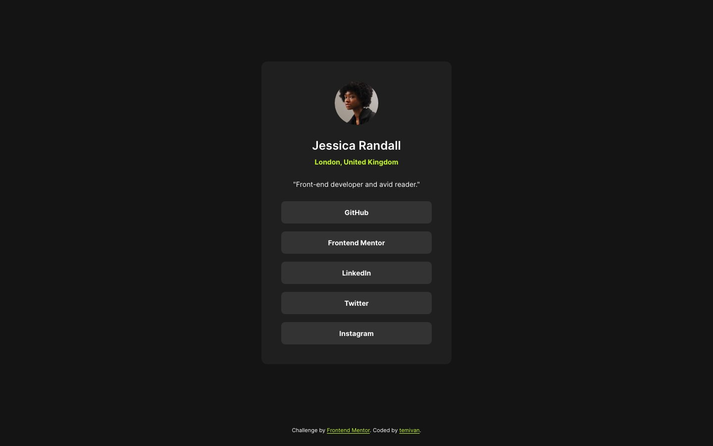

# Frontend Mentor - Social links profile solution

This is a solution to the [Social links profile challenge on Frontend Mentor](https://www.frontendmentor.io/challenges/social-links-profile-UG32l9m6dQ). The original challenge brief is kept in [`CHALLENGE.md`](./CHALLENGE.md).

## Table of contents

- [Overview](#overview)
  - [The challenge](#the-challenge)
  - [Screenshot](#screenshot)
  - [Links](#links)
- [My process](#my-process)
  - [Built with](#built-with)
  - [Notes](#notes)
  - [Running locally](#running-locally)
  - [AI Collaboration](#ai-collaboration)
- [Author](#author)

## Overview

### The challenge

Users should be able to:

- See hover and focus states for all interactive elements on the page

### Screenshot



### Links

- Solution URL: [github.com/temivan/social-links-profile](https://github.com/temivan/social-links-profile)
- Live Site URL: [temivan.github.io/social-links-profile](https://temivan.github.io/social-links-profile/)

## My process

### Built with

- Semantic HTML5 markup
- Flexbox
- Mobile-first workflow
- [React](https://react.dev/) with TypeScript
- [Vite](https://vite.dev/) - build tool
- [Tailwind CSS v4](https://tailwindcss.com/) - via the official Vite plugin, with design tokens in a `@theme` block
- [Oxlint](https://oxc.rs/docs/guide/usage/linter) and [oxfmt](https://oxc.rs/docs/guide/usage/formatter) - linting and formatting
- [pnpm](https://pnpm.io/) - package manager
- GitHub Actions and GitHub Pages - deployment

### Notes

- **Design tokens.** The style guide's colours, the Inter font and the type presets live in a Tailwind `@theme` block in `src/index.css`. The default palette is cleared, so components can only use the named tokens.
- **Content model.** All profile content (name, location, bio, avatar, links) and the footer author credit sit in one typed module, `src/data/profile.ts`. Components only render it.
- **Accessibility.** The page has one `main` landmark, an `h1` for the name, and a labelled `nav` holding the links as a list. Each link opens in a new tab and says so to screen readers with a visually hidden "(opens in a new tab)" label.
- **Interaction states.** Hover turns a button green with dark text. Keyboard focus (`:focus-visible`) looks the same and adds an offset outline ring. Colour transitions are switched off for visitors who prefer reduced motion. The hover text is grey-900, not the grey-700 shown in Figma. This is deliberate: it follows the spec and gives better contrast on the green.
- **Self-hosted font.** Inter is loaded from the starter's variable font with `@font-face`, covering weights 400 to 700 in one file.
- **Deployment.** Every push to `main` runs `.github/workflows/deploy.yml`, which builds with pnpm and publishes `dist/` with the official Pages actions. Vite's `base` is `/social-links-profile/` so assets resolve under the repo path.

### Running locally

```sh
pnpm install
pnpm dev            # start the dev server
pnpm build          # type-check and build to dist/
pnpm preview        # serve the build at http://localhost:4173/social-links-profile/
pnpm lint           # Oxlint
pnpm format:check   # oxfmt check
```

### AI Collaboration

I used Claude Code to scaffold the tooling, build the components from the Figma frames, write the deploy workflow and draft this README. I reviewed the output against the design and the challenge requirements.

## Author

- GitHub - [@temivan](https://github.com/temivan)
